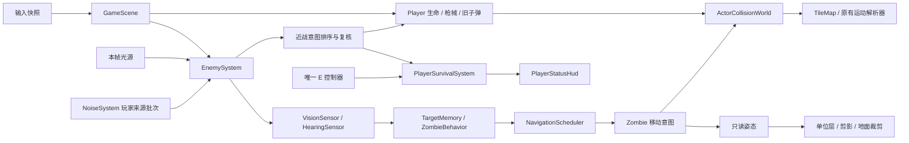

# 丧尸敌人系统：最终架构与实施说明

实施依据：V1.1；日期：2026-11-01。工作分支 `codex/mouse-aim-shooting`。基线及实际验证、代码提交见同目录 `zombie-system-test-report.md`。

## 1. 已落地的玩法

默认每局在玩家实际出生位置和配置确定后，生成 2 只 Shambler、2 只 Runner、2 剂地面疫苗，疫苗库存为 0。丧尸能游荡、调查玩家声音、确认视觉后追击、沿最后合法记忆追踪、搜索和近战；成功造成近战伤害后按类型概率感染玩家。感染每秒扣 1 HP，持续到 V 使用疫苗。疫苗按住 E 0.5 秒拾取，拾取只增加库存。

六项锁定决策全部接入运行时：

1. 玩家和丧尸、丧尸之间使用同一连续运动解析器阻挡；小鸡仍不参与角色阻挡。
2. 疫苗来自初始地图生成；丧尸死亡不生成疫苗或鸡肉。
3. 玩家死亡后旧子弹、敌人和世界继续运行，主动行为失效；新的 Enter 返回菜单，释放并重新按 Enter 才开始新局。
4. 玩家手电有效光束照到丧尸时，为视觉采样提供持灯者暴露信息；不能绕过丧尸视锥、LOS 和确认时间。
5. 每次有效命中均结算伤害和击退；仅在 0.45 秒硬直冷却结束后触发一次新的硬直及攻击取消。
6. F2 暂停世界玩法和世界音频，保留画面配置与面板交互。恢复后不补算暂停时间、不补发按键。

没有加入背包、撤离结算、持续刷怪、扑击位移、翻滚免伤或敌人骨骼编辑器。敌人使用程序化俯视人形；两种体型、配色与速度不同，不显示血条。

## 2. 文件与职责

| 文件/目录 | 责任 |
| --- | --- |
| `src/combat/DamageableTarget.ts` | 小鸡和丧尸共同满足的结构化伤害目标接口 |
| `src/combat/HitTargetResolver.ts` | 纯线段命中查询，返回目标、接触比例及点，不结算伤害 |
| `src/combat/PlayerDamage.ts` | 玩家生命状态、伤害事件、伤害结果、近战保护常量与验证 |
| `src/physics/ActorCollisionWorld.ts` | 100 像素空间格、角色查询、地形与角色联合 sweep、受地形约束的分离 |
| `src/navigation/NavigationGrid.ts` | 半径相关通行节点、边、端点连接、通行代价与 revision 缓存 |
| `src/navigation/NavigationScheduler.ts` | 稳定二叉堆、分步 A*、公平队列、取消、分步路径重建和平滑 |
| `src/enemies/ZombieConfig.ts` | 两类丧尸全部首轮参数、感知与击退配置，构造时校验并冻结 |
| `src/enemies/Zombie.ts` | 位置、圆碰撞体、生命、移动、独立击退、硬直和死亡收尾 |
| `src/enemies/TargetMemory.ts` | 只保存合法视觉/听觉产生的位置快照及年龄 |
| `src/enemies/ZombieBehavior.ts` | `wander / investigate / chase / search` 决策，不持有 Player 引用 |
| `src/enemies/MeleeAttackController.ts` | 冻结方向的攻击周期、一次命中时刻、取消及不缩短的恢复期限 |
| `src/enemies/ZombieRenderer.ts` | 只读姿态；彩色与剪影共用轮廓和动作；阴影不修改世界 |
| `src/enemies/EnemySystem.ts` | 集合、感知、路径跟随、攻击意图、噪声、死亡移除及开发快照 |
| `src/enemies/EncounterSpawning.ts` | 加载期连通区域与有界候选生成，用于丧尸和玩家体型可达的疫苗 |
| `src/survival/` | 感染计时、安全整数库存、拾取入库、原子治疗及生命重置 |
| `src/interaction/InteractablePickup.ts` | 肉块和疫苗共享 ID、类型、配置、锚点、边界与一次性拾取契约 |
| `src/objects/VaccinePickup.ts` | 20 像素无阻挡、立即可拾取的地图物品 |
| `src/ui/PlayerStatusHud.ts` | 只读感染/库存/V 提示，窄屏一行 |

`GameScene` 只负责把现有系统按时序连接、包装命中回调及单位层合成；敌人内部不回调修改场景私有状态。



## 3. 命中与生命的边界

`DamageableTarget` 需要 `isDamageable()`、`hitTestSegment(...)` 和 `receiveHit(impact, world?)`。`resolveFirstDamageableHit(query, entries)` 不调用最后一个方法。场景把查询结果包装为原有 `BulletEntityHit.apply`，由 Bullet 决定实体和地形中哪个先命中，只调用一次最终回调。小鸡候选保持原顺序，再追加丧尸；火把需要瞄准火苗的特殊规则及既有并列优先级不变。

玩家生命由 Player 唯一持有：

```ts
type PlayerLifeState = 'alive' | 'dead';
type PlayerDamageKind = 'melee' | 'infection' | 'script';
interface PlayerDamageEvent { amount: number; kind: PlayerDamageKind; sourceId?: string; attackId?: string; }
interface PlayerDamageResult { appliedAmount: number; killed: boolean; blocked: boolean; }
```

伤害先校验再修改。近战实际扣血后保护 0.35 秒，感染和脚本伤害不受这层保护。`takeDamage` 委托为 script；首次致死事件可消费一次，死亡原因保留。普通 `heal`、修改当前血量和调整最大生命都不能复活。`resetLifeState()` 是显式生命入口；生存系统的 `resetLife()` 进一步清除感染，保留库存。

死亡取消全部槽位未完成换弹、翻滚、射击姿态和主动输入；Player.update 的死亡路径仍更新旧子弹。丧尸沿用 `alive / dying / removed`，攻击及硬直属于动作状态，没有另一份生命状态机。

## 4. 角色运动与地形

Entities 的 `setMotionResolver` 是可选扩展；没有注入时仍走原地图解析。玩家与每只丧尸的普通移动、翻滚和丧尸独立击退都通过 ActorCollisionWorld。角色圆作为障碍，与附近静态几何共同交给现有 `resolveMotion`，避免仅依靠移动后推开重叠。

空间格边长 100，查询及分离按稳定 ID 顺序进行。分离最多四轮，每次修复最多 4 像素，修复也 sweep 地形，并拒绝加重第三方重叠的落点。拥堵时停止或等待；不把动态角色写进静态导航图。活体和 dying 丧尸阻挡，removed 时注销。

玩家在后置重叠修复中固定，由丧尸让开：这样保留已经采样的玩家、光源及相机位置，死亡玩家也不会被后置修复挪动。它仍在所有连续 sweep 中参与双方阻挡。空间不足时可以保留保守重叠，而不穿墙或传送。

KnockbackMotion 新增可选落位判定。默认仍要求完全干地，保持小鸡规则；丧尸允许速度因子大于 0 的可通行水面。真实地形与角色碰撞继续由 sweep 限制。

## 5. 导航与预算

- 格宽跟随当前 TileMap.tileSize（默认 50）；节点检查完整圆体，八方向，固定邻居顺序，对角边检查相邻正交节点。
- 节点边、实际起终点连接都做真实半径 Shape Cast。代价积分 `1 / speedFactor`，采样间距不大于四分之一格；速度因子 0 不可通行。
- 确认为纯干地的直达段可以直接返回；减速水面仍进入带权搜索。Octile 下界计算到终点连接节点，再加实际连接代价，保持可采纳性。
- 平滑每次最多前看八段；捷径碰撞合法且估算成本不超过原段的 105%。重建和平滑也分片运行，避免最终一帧集中处理长路径。

| 约束 | 默认值 |
| --- | ---: |
| 节拍 | 游戏时间 30 Hz |
| 每节拍启动 | 2 |
| 同时活动任务 | 4 |
| 每节拍工作上限 | 512 |
| 单任务轮转工作配额 | 128 |
| 单次搜索节点展开上限 | 10,000 |
| 普通重规划间隔 | 0.45 s |
| 静态段失效最短重试间隔 | 0.15 s |
| 失败退避 | 1 s |

一个工作单位是一次堆弹出、一个重建节点或一次有界平滑候选检查。因此实际展开节点数也不超过 512；过期堆记录不会逃过预算。诊断分别统计 expanded 和 workUnits。

无路径的追击者优先级更高，排队年龄不断增加，最终能超过新来的高优先级请求。每角色只留一个最新任务，小于 25 像素的目标变化合并；较大变化在重规划间隔允许后替换。死亡、场景退出、地图 revision 或体型变化取消旧任务和路径。

结果为 `pending / found / invalid / unreachable / budgetExceeded / cancelled`。非法或阻挡起点不搬动；地图外目标无效。阻挡目标按距离枚举 100 像素内的合法格点，依次验证连通性。预算不足报告 budgetExceeded，不谎称不可达。路径跟随每帧复核下一段的真实碰撞和通行代价，失效先停车。

`TileMap.getNavigationRevision()` / `invalidateNavigation()` 是显式缓存契约。矿石非致命受伤不变，破坏地形递增，重复破坏空地不变。直接改 tiles、tileSize 或移动成本后，调用方必须 invalidate；原有地形几何仍由自己的指纹缓存维护。

## 6. 感知、记忆与战斗

场景每帧共享一次 `selectPlayerNoises` 结果。只有 sourceId 为 player 的脚步、涉水、翻滚、枪声以及可靠标记的 impact/mining 能进入追踪；其他来源不进入。HearingSensor 使用有界逐事件 ID 集合，只有实际听见才加入，按当前新鲜事件清理。`getLastProcessedId()` 保留为最大已听 ID 的诊断值；强度相同依次比较新鲜度和事件 ID。

VisionTarget 的 `emittingLightId` 指向玩家手电。必须光源开启、允许细节、丧尸处于有效光束、强度至少 0.3 且光束 LOS 成立，才切到明亮视距；视觉自身 LOS、视锥和连续确认仍要通过。脚边微光不提供辨识能力。nearHalfAngleDeg 的近身角度现已实际参与判定，默认 180° 保持小鸡兼容。

当前确认视觉优先，丢失后只读最后看见的位置；达到记忆终点或过期后搜索。声音可更新调查或搜索目标。普通行为不会拿实时玩家位置作路径目标；玩家坐标只用于视觉采样和攻击几何复核。

攻击从攻击者中心量 60 像素，半角 45°，用扇形与玩家圆相交判断，不叠加攻击者半径。起手要求确认视觉和 LOS。前摇冻结方向和普通平移；越过命中时间产生一个 `actorId:sequence` 意图，按发生时间/稳定 ID 排序，再查生命、攻击有效性、几何和 LOS。落空同样占用完整周期。成功硬直取消攻击，但保留已经承诺的恢复截止时间。优先级为死亡、硬直、攻击、行为。

| 首轮参数 | Shambler | Runner |
| --- | ---: | ---: |
| 尺寸 / 碰撞半径 | 46 / 23 | 44 / 22 |
| 生命 | 55 | 40 |
| 游荡 / 追击速度 | 26 / 68 | 32 / 205 |
| 追击加速度 | 380 | 1100 |
| 伤害 | 12 | 9 |
| 前摇 / 后摇 | .55 / 1.10 s | .32 / .90 s |
| 感染概率 | .12 | .18 |
| 搜索 | 5 s | 7 s |
| 硬直 / 冷却 | .14 / .45 s | .10 / .45 s |
| 近身 / 明亮 / 黑暗视距 | 75 / 300 / 140 | 75 / 350 / 170 |
| 远视锥半角 / 连续确认 | 60° / .30 s | 60° / .20 s |
| 质量 / 抗性 / 击退速度上限 | 1.6 / .20 / 260 | .9 / .05 / 400 |
| 死亡可见最短 / 最长 | .20 / .65 s | .16 / .55 s |

两类共用：听觉阈值 .08、隔墙 .4、新鲜 .3 s；视觉/听觉记忆 3/8 s、到达半径 25、漫游半径 150、停顿 1 s、搜索半径 100；击退阻尼 7、停止速度 10、致死倍率 1、收尾距离 12。时间、概率、正尺寸/生命、近身与黑暗视距关系都校验，感知和击退复用原验证器。

## 7. 生存、交互与 HUD

感染非叠层，不刷新计时；只有实际近战扣血且玩家仍存活才抽取概率，已感染不重复抽取。DOT 用算术累计整秒及余量，大 delta 不循环逐次扣血。死亡、治疗和显式重置清除感染计时；新感染到下一次世界更新才累计。

最小库存只保存非负安全整数。拾取先确认容量及一次性 markCollected，再入库。V 的同步方法先验证存活、感染、库存、未暂停、非翻滚、非换弹、未按 E、无本帧开火/翻滚/切枪/换弹输入，随后一次性扣库存并清除感染，不回血。

唯一 InteractionController 的排序、锁定和释放语义保留：距离优先，同距看物品优先级（疫苗 1、肉块 0）及稳定 ID；12 像素切换滞回；按住后锁定，范围内移动不中断；一次按住只完成一件。死亡、失焦、开火、翻滚、切枪、F2、松开或离开范围取消。hidden 无候选，近身剪影加 LOS 仍能触觉交互。提示读取目标边界，键帽仍为原来的 28 CSS 像素。

PlayerStatusHud 位于武器列表下方；窄于 650 CSS 像素时合并成屏幕底部一行。它只读快照，不拥有生命、感染或库存。死亡态显示“已死亡”，原因由死亡覆盖层显示。

## 8. 场景时序、暂停和清理

每次有效世界更新：

1. 读取一次 Input.captureFrame；推进旧噪声年龄和近战保护；合法 V 先于已有感染 DOT。
2. 更新玩家和旧子弹。随后处理 R、Tab、C、Space，保留同帧射击先于切枪。
3. 更新火把/光源，处理 G，生成共享的本帧感知光源。
4. 丧尸感知、记忆、行为、导航任务、移动、角色分离，收集攻击意图。
5. 复核近战、感染抽取、玩家死亡和敌人死亡完成事件。
6. 更新鸡、掉落物、效果、增益、玩家感知、小地图、声音提示。
7. 存活玩家的唯一 E 交互，最后更新武器和手电 HUD。

子弹先于本帧近战，因而致命命中或成功打断能取消近战。新感染不会在同一帧推进 DOT。主循环继续使用原有最大 1/30 秒有效 delta。

F2 的状态回调立即暂停 SoundPlayer、取消交互并清理输入。Scene.update 在所有世界推进之前返回，只有调试面板刷新；draw 传给地图的 delta 为 0，地形高亮也冻结。Input 的帧快照消费一次 click edge；清理后重复 keydown 不会重新获得游戏输入，必须新的按下。失焦版本号会使进行中的 E 从头开始。

SoundPlayer.pauseAll/resumeAll 不改 currentTime；淡出计时也冻结。stopAll 停止循环与一次性声部、清理渐变并使旧句柄失效。onExit 清空敌人、导航、角色注册、感染、库存、噪声、声音提示、血迹、交互、准星 DOM、面板、地图 HUD 缓存和场景事件监听；共享的 Game/Input 生命周期不被场景销毁。

## 9. 表现与调试

丧尸和疫苗完整加入感知 target、单位层包围盒、剔除、阴影、剪影及交叉淡化。丧尸本体额外受地面轮廓裁剪，不能把伸出碰撞体的手臂画到墙顶。dying 保留身份，removed 才注销。敌人血迹使用单独的普通血迹容器并受当前位置辨识约束；鸡肉持续血迹不变。

准星仅对可辨识、存活的丧尸反馈；小地图不注册实时敌人，疫苗按已辨识 pickup 规则注册。

场景噪声容量显式为 1024，NoiseSystem 默认仍为 64。脚步由实际位移累计，攻击声在起手产生，低吼按种子计时，死亡后不发新事件。玩家听到这些事件使用原模糊涟漪，已辨识声源不重复提示。当前没有新增丧尸采样，逻辑噪声与提示可用，音频静默，不请求不存在的文件。

开发构建使用 `?zombieDebug=paths` 查看路径；`getZombieDebugState()` 提供独立敌人、记忆、路径、队列、工作量、CPU、库存和生成报告。生产构建编译期忽略路径 URL 并返回 null 调试快照，不向 F2 添加敌人参数。

## 10. 生成、复现及验证入口

GameSceneOptions 兼容旧 TileMapOptions，并支持固定 map、playerSpawn、seed、encounters 以及独立鸡数量。正常启动无需任何选项。地图、玩家出生、火把、小鸡、敌人、疫苗使用独立种子流，每只丧尸再分配自己的决策流；绘制不消耗它。

加载期计算半径对应连通区域；每个生成目标最多 200 次候选。丧尸位于 350–900 像素干地，疫苗优先在 100–350 像素内，并以玩家实际半径检验可达性。数量不足会保留 spawnReports 并输出原因，不修改地图或强行安放。连通组件预计算属于加载阶段，不计入世界每帧搜索预算。

复现边界为相同地图、初始状态与合法感知/命中事件流；不声称现有武器散布等全项目随机行为完整回放确定。

`tests/fixed-scene.ts` 只用于原有隔离场景，显式构造旧用例原本要求的空世界，不再更换私有 map 而留下过期碰撞世界。`tests/zombie-fixture.html` 独立覆盖默认 4 敌人与 2 剂疫苗及压力数量。所有原有断言保留；F2 用例同时验证暂停不推进与恢复后原进度继续。

执行 typecheck、Node 全集、build、原 browser 全集、zombie-browser 和 zombie-performance。性能目标与实测分开；压力档不承诺 60 FPS，GPU/GC 不可观测项目在报告中留空而不推算。
